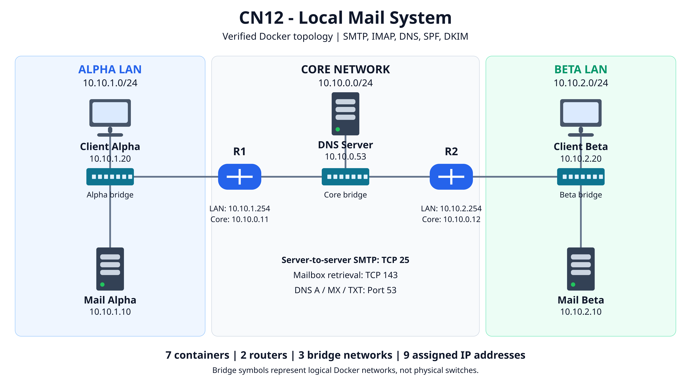

<div align="center">


# CN Mail — Local Mail System

### Secure Email Communication Across Two Local Domains

<p>
  
  
  
  
</p>

<p>
  
  
  
  
  
</p>

</div>

---

## 📌 Project Overview

**CN Mail** is a Docker-based local email communication system that enables secure email exchange between two independent domains: `alpha.lab` and `beta.lab`.

The network infrastructure consists of two Linux routers and three IPv4 subnets, enabling communication between both domains through static routing.

The project integrates SMTP-based email transmission, IMAP-based retrieval, DNS configuration, SPF and DKIM authentication, and STARTTLS encryption.

It also features a Python-based desktop GUI with purple-themed light and dark modes for sending and receiving emails.

## ✨ Key Features

| Feature | Description |
|---|---|
| 📤 SMTP | Email transmission using Postfix |
| 📥 IMAP | Email retrieval using Dovecot |
| 🌐 DNS | A, MX and TXT record configuration |
| 🛡️ SPF | Sender authentication and validation |
| 🔐 DKIM | Digital signature generation and verification |
| 🔒 STARTTLS | Encrypted email communication |
| 🖧 Routing | Static routing across three IPv4 subnets |
| 📊 Wireshark | Network protocol analysis |
| ⚡ Benchmarking | Network performance experiments |
| 🖥️ Desktop GUI | Python-based sender and receiver interfaces |
| 🎨 Themes | Purple light and dark GUI modes |

## 🏗️ Network Architecture

<div align="center">



**Final Network Topology**

</div>

### IP Addressing Scheme

| Network | Subnet |
|---|---|
| Alpha LAN | `10.10.1.0/24` |
| Core Network | `10.10.0.0/24` |
| Beta LAN | `10.10.2.0/24` |

## 🛠️ Technology Stack

<div align="center">


</div>

| Technology | Usage |
|---|---|
| Python & Tkinter | Desktop GUI |
| Ubuntu Linux | Host environment |
| Docker & Docker Compose | Containerized infrastructure |
| Postfix | SMTP mail server |
| Dovecot | IMAP mail server |
| BIND9 | DNS services |
| OpenDKIM | DKIM authentication |
| Wireshark | Network traffic analysis |
| Linux Traffic Control | Network emulation using Netem and TBF |

## 🚀 Getting Started

### Prerequisites

- Ubuntu Linux environment
- Docker and Docker Compose
- Python 3
- Tkinter

### 1. Start Docker

```bash
sudo systemctl start docker
```

### 2. Start the Mail Infrastructure

```bash
./run-cn12.sh up -d --no-build
```

### 3. Verify Running Containers

```bash
./run-cn12.sh ps
```

> **Note:** A fresh installation requires building the Docker images and configuring private credentials, DKIM keys, and TLS certificates.

## 🖥️ Launch the Desktop GUI

Install Tkinter if required:

```bash
sudo apt install python3-tk
```

Open two separate terminals.

**Terminal 1 — Sender**

```bash
python3 cn12_demo_gui.py sender
```

**Terminal 2 — Receiver**

```bash
python3 cn12_demo_gui.py receiver
```

The sender and receiver interfaces provide a simple way to demonstrate email transmission and retrieval through the local mail infrastructure.

## 📊 Testing & Performance Results

<div align="center">

| Test Category | Result |
|:---:|:---:|
| Functional Tests | **20/20 Passed** |
| Wireshark Scenarios | **10/10 Completed** |
| Performance Experiments | **15/15 Passed** |
| Workload Emails Delivered | **15,000/15,000** |
| SPF Positive Pass Rate | **100%** |
| DKIM Positive Pass Rate | **100%** |
| SMTP Command Measurements | **360** |
| STARTTLS Comparison Transactions | **60** |

</div>

### 🔍 Security Validation

- Unauthorized SPF senders were successfully rejected.
- Tampered DKIM signatures were successfully detected.
- STARTTLS encryption was evaluated through comparison experiments.
- SMTP and IMAP communication were examined through packet captures.

> **Note:** Delivery latency measurements are estimates. The system is intended for an isolated educational environment, not production email deployment.

## 📂 Project Evidence

All major testing results, packet captures, screenshots, and statistical analysis are available in the repository.

<details>
<summary><b>📁 View Functional Testing & Protocol Analysis</b></summary>

- [Functional Tests](captures/final-evidence/02_Functional_Tests/)
- [Wireshark Captures](captures/final-evidence/03_Wireshark/)

</details>

<details>
<summary><b>📈 View Performance & Statistical Analysis</b></summary>

- [Performance Experiments](captures/final-evidence/04_Performance_Experiments/)
- [Additional Measurements](captures/final-evidence/05_Additional_Measurements/)
- [Statistics and Graphs](captures/final-evidence/06_Statistical_Analysis/)

</details>

<details>
<summary><b>🖼️ View Architecture & Final Screenshots</b></summary>

- [Network Architecture](captures/final-evidence/07_Network_Architecture/)
- [Final Product Verification](captures/final-evidence/08_Final_Product_Verification/)
- [Screenshots](captures/final-evidence/09_Screenshots_Review/)

</details>

## 👨‍💻 Team Members

<div align="center">

| Team Member | Roll Number |
|:---:|:---:|
| **Zaid Faraz** | 24K-0636 |
| **Muhammad Adil Saeed** | 24K-0705 |

**Instructor:** Dr. Ghufran Ahmed

**FAST National University of Computer and Emerging Sciences**

</div>

## 🤖 AI Disclosure

AI tools assisted with implementation, debugging, and documentation. Experimental testing, verification, and validation were performed by the team in its laboratory environment.

## 🔐 Security

Private passwords, password hashes, and cryptographic private keys are excluded from the repository to prevent exposure of sensitive information.

---

<div align="center">

### Built for CS3001 — Computer Networks

**FAST NUCES | Fall 2026**


</div>
